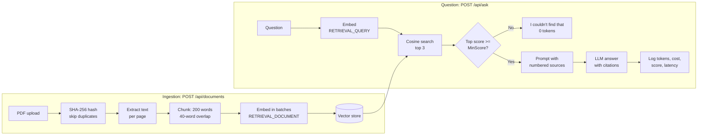

# PolicyQA API

A retrieval-augmented generation (RAG) API in ASP.NET Core that answers questions about policy PDFs with page-level citations, and says "I couldn't find that in the documents" when the answer isn't there.

Built as a hands-on learning project to apply production engineering practices (clean architecture, cost tracking, evaluation, resilience, testing) to a GenAI feature. It runs on the Gemini API free tier and should only be used with public sample documents.

## How it works



## Endpoints

| Method | Path | Purpose |
| --- | --- | --- |
| POST | `/api/documents` | Upload a PDF (multipart form field `file`). Duplicate uploads are skipped; a new version of the same file name replaces the old chunks. |
| POST | `/api/ask` | `{ "question": "..." }` → answer, sources (file, page, score, preview), tokens, estimated cost, latency. |
| GET | `/api/usage` | Running totals: LLM requests, skipped calls, tokens, estimated cost. |
| POST | `/api/eval` | Runs the labeled questions in `evalset.json` and reports retrieval hit rate, answer correctness and refusal accuracy. |

## Project structure

| File | Responsibility |
| --- | --- |
| `Program.cs` | Dependency injection, HttpClient setup, endpoints, error mapping |
| `GeminiClient.cs` | `ILlmClient`: calls the Gemini Interactions API, parses answer and token usage |
| `GeminiEmbeddingClient.cs` | `IEmbeddingClient`: batched document embeddings and query embeddings |
| `GeminiHttp.cs` | Shared HTTP call with retries and exponential backoff for 429/503/504 |
| `TextChunker.cs` | Word-based chunking with overlap |
| `VectorStore.cs` | `IVectorStore`: in-memory store, duplicate detection, cosine search |
| `IngestionService.cs` | Hash, extract, chunk, embed, store |
| `RagService.cs` | Retrieve, threshold, grounded prompt, generate, log |
| `UsageTracker.cs` | Token and estimated cost totals |
| `EvalService.cs` + `evalset.json` | Labeled evaluation |
| `tests/PolicyQA.Tests` | xUnit tests with faked LLM and embeddings |

## Run it

Requirements: .NET 8 SDK or later, a free Gemini API key from Google AI Studio.

```bash
dotnet user-secrets init
dotnet user-secrets set "Gemini:ApiKey" "YOUR_KEY"
dotnet run
```

Then:

```bash
curl -F "file=@sample-policy.pdf" http://localhost:5000/api/documents
curl -X POST http://localhost:5000/api/ask -H "Content-Type: application/json" -d "{\"question\":\"How many vacation days do I get?\"}"
curl -X POST http://localhost:5000/api/eval
curl http://localhost:5000/api/usage
```

Run the tests:

```bash
dotnet test tests/PolicyQA.Tests
```

The vector store is in memory, so re-upload documents after each restart.

## Configuration

| Setting | Default | Notes |
| --- | --- | --- |
| `Gemini:ChatModel` | `gemini-3.5-flash-lite` | Pin a stable version; avoid `-latest` and preview aliases in production |
| `Gemini:ThinkingLevel` | `low` | Policy lookup needs little reasoning: fewer tokens, faster answers |
| `Gemini:EmbeddingModel` | `gemini-embedding-001` | Changing it requires re-embedding all documents |
| `Gemini:EmbeddingDimensions` | `768` | Smaller than the 3072 default: less storage and faster search |
| `Gemini:TimeoutSeconds` | `30` | Fail fast instead of the 100-second HttpClient default |
| `Rag:TopK` | `3` | Chunks sent to the LLM |
| `Rag:MinScore` | `0.0` (off) | Similarity threshold; tune with the eval set |
| `Rag:ChunkSizeWords` / `ChunkOverlapWords` | `200` / `40` | Tune with the eval set |
| `Pricing:*PerMillionTokens` | placeholders | Set to the current paid-tier price to estimate production cost |

The API key is never stored in the repository: User Secrets locally, Azure Key Vault with Managed Identity in production.

## Design decisions

- **Interfaces for every external dependency** (`ILlmClient`, `IEmbeddingClient`, `IVectorStore`). Switching to Azure OpenAI or Azure AI Search means one new class and one registration change, and tests run against fakes with no API calls (dependency inversion).
- **Page-aware chunks with overlap.** Every answer can cite "file, page N", and rules aren't split across chunk boundaries.
- **Separate task types for documents and questions** improve matching between short questions and long passages.
- **Grounded prompt with guardrails.** Answer only from numbered sources, cite them, refuse when the answer is missing, and treat source text as data, not instructions (a prompt-injection defense, not a complete one).
- **Similarity threshold.** In testing, relevant questions scored about 0.69 to 0.71 and unrelated ones about 0.48. A threshold can skip the LLM for weak matches; set too high, it wrongly rejects valid questions, so it is chosen from evaluation data.
- **Cost visibility.** A typical answer used about 880 input tokens and 30 output tokens: the retrieved context is most of the cost, so cost control focuses on retrieval (top-k, chunk size, threshold).
- **Same code path for evaluation.** `/api/eval` calls the same `RagService` as `/api/ask`, so evaluation results reflect production behavior.
- **Resilience.** Explicit timeout, retries with exponential backoff for transient errors, and clean 502/504 responses instead of stack traces.
- **Duplicate handling.** Content hashing skips identical uploads; a changed file with the same name replaces its old chunks. Embeddings are created before the store is touched, so a failed call never deletes the previous version.

## Evaluation

`evalset.json` holds labeled questions: answerable ones with an expected page and expected facts, plus out-of-scope ones that should be refused. The report scores three layers separately:

- **Retrieval hit rate:** was the expected page in the top-k sources? Low → tune chunking, top-k, or add hybrid search.
- **Answer correctness:** does the answer contain the expected facts? Low with good retrieval → tune the prompt or model.
- **Refusal accuracy:** refuses only unanswerable questions. Errors → tune the threshold or prompt.

The "contains" check is cheap but brittle ("fifteen" vs "15"). At larger scale, LLM-as-a-judge and tools like LangFuse, LangSmith or MLflow would track results over time. Edit `evalset.json` to match the sample document you use.

## Known limitations

- In-memory storage is lost on restart and uses brute-force search.
- Scanned PDFs have no text layer and need OCR; tables and multi-column layouts may extract imperfectly.
- No authentication or per-user document permissions yet.
- Embedding calls are not included in the cost estimate (they are small compared to generation).

## Roadmap

- Persist chunks in SQL Server or Azure AI Search, with document-level access control
- React front end for upload, chat and cited sources
- Agent mode: a `getLeaveBalance` tool reading from SQL, combined with policy search
- Azure OpenAI implementation of `ILlmClient` and `IEmbeddingClient`
- CI pipeline (GitHub Actions): build, tests, and the eval set as a quality gate
- Streaming responses and LLM-as-a-judge evaluation
